# Ticket rewrite 2: new-format descriptions (14 Oct 2026)

Rewrite of 11 existing Jira bugs into the owner's new ticket format (Simple explanation, highlighted key screenshot, optional EXPECTED mock-up, Actual / Expected, Test data, Steps, Notes for the developer). **Nothing was written to Jira.**

- Machine-readable payload: `docs/bug-evidence/2026-10-14-ticket-rewrite/payload-2.json` (key, summary, desc in Jira wiki markup, files_to_attach).
- New images (all in `docs/bug-evidence/2026-10-14-ticket-rewrite/`): one `<KEY>-key-highlighted.png` per ticket, plus `<KEY>-expected-mockup.png` for ZP-4868, 4869, 4870, 4871, 4880, 4882, 4893.
- Every `!image!` in a description is either already attached to that ticket or listed in files_to_attach. Step screenshots reuse the existing attachments by exact filename.
- Apply order per ticket: upload files_to_attach, then set the description (wiki renderer), then the summary. Priorities are unchanged.
- Facts follow the 13 Oct audits (`2026-10-13-bug-audit-B.md`, `-C.md`, `-edits.md`) and the 14 Oct users-list check (ZP-4893: all 246 users are Acme's own).

| Ticket | New title | Files to attach |
|---|---|---|
| [ZP-4855](https://egalvanic.atlassian.net/browse/ZP-4855) | [Web] Bulk Edit server calls crash on a badly formed site id instead of answering "invalid site id" (API only, not reachable from the screen) | `ZP-4855-key-highlighted.png` |
| [ZP-4865](https://egalvanic.atlassian.net/browse/ZP-4865) | [Web] SLD: a user who is not assigned to a site can still change that site's diagram (connections, asset data, asset positions), and the change is saved for everyone | `ZP-4865-key-highlighted.png` |
| [ZP-4866](https://egalvanic.atlassian.net/browse/ZP-4866) | [Web] Client Portal users can open the full Arc Flash Readiness page (with report export) by typing its address, although their menu hides it | `ZP-4866-key-highlighted.png` |
| [ZP-4868](https://egalvanic.atlassian.net/browse/ZP-4868) | [Web] Work order forms: in a multi-pick list, every tick clears the search text, so picking several people means typing the search again each time | `ZP-4868-key-highlighted.png`, `ZP-4868-expected-mockup.png` |
| [ZP-4869](https://egalvanic.atlassian.net/browse/ZP-4869) | [Web] SLD PDF export: the "TO …" name tag of a hidden connection is printed under the asset symbol at a left-side terminal, so the name cannot be read | `ZP-4869-key-highlighted.png`, `ZP-4869-expected-mockup.png` |
| [ZP-4870](https://egalvanic.atlassian.net/browse/ZP-4870) | [Web] Form builder preview (Web View): fields that list the company's users show no names, so form authors cannot try them (Test Equipment fields work) | `ZP-4870-key-highlighted.png`, `ZP-4870-expected-mockup.png` |
| [ZP-4871](https://egalvanic.atlassian.net/browse/ZP-4871) | [Web] Work order Forms tab: two different forms that have no form key are listed under one form's name, so users open the wrong form | `ZP-4871-key-highlighted.png`, `ZP-4871-expected-mockup.png` |
| [ZP-4876](https://egalvanic.atlassian.net/browse/ZP-4876) | [Web] SKM import: re-importing an unchanged SKM export silently changes the class of existing assets (12 of 94 on the test site, e.g. PDU → Panelboard, Lightning Arrester → Load) | `ZP-4876-key-highlighted.png` |
| [ZP-4880](https://egalvanic.atlassian.net/browse/ZP-4880) | [Web] Asset › Maintenance › Add Service History: a future "Last serviced" date shows a raw technical error instead of a plain message (and the date box allows future dates) | `ZP-4880-key-highlighted.png`, `ZP-4880-expected-mockup.png` |
| [ZP-4882](https://egalvanic.atlassian.net/browse/ZP-4882) | [Web] SLD Issues list calls an Inverter and a Rectifier a "Transformer" ("no secondary winding voltage"): wrong, confusing wording | `ZP-4882-key-highlighted.png`, `ZP-4882-expected-mockup.png` |
| [ZP-4893](https://egalvanic.atlassian.net/browse/ZP-4893) | [Web] Asset › Infrared › Add reading: the Technician list offers every user account of the company, many shown as full email addresses (customer addresses, egalvanic.com logins, old accounts) | `ZP-4893-key-highlighted.png`, `ZP-4893-expected-mockup.png` |

## ZP-4855

**Title:** [Web] Bulk Edit server calls crash on a badly formed site id instead of answering "invalid site id" (API only, not reachable from the screen)  
**Files to attach:** `ZP-4855-key-highlighted.png`

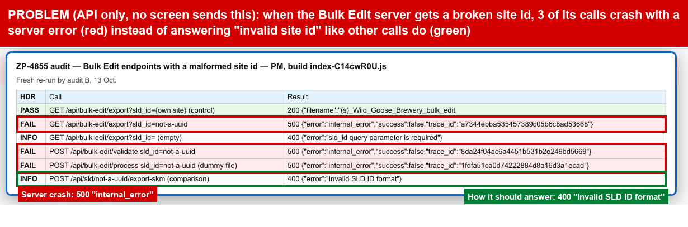

```
h3. Simple explanation
On *Site Data › Assets*, Bulk Edit lets a user export all assets of the current site to a spreadsheet, check it and import it back.
The screen always sends the id of the site the user picked, so a normal user cannot reach this problem from the screen.
If the same three server calls (export, check, import) are sent with a broken site id, for example "not-a-uuid", the server crashes with an internal error.
Other parts of the app answer the same mistake politely, with "Invalid SLD ID format".
Nothing is changed and no data is shown, so this is a clean-up issue (Low).
It matters because every crash lands in the server error logs and hides real problems, and any script or integration gets no useful answer.
The server should answer "invalid site id" instead of crashing.

!ZP-4855-key-highlighted.png|width=720!

h3. Actual result
All three Bulk Edit calls answer with a server crash (HTTP 500, "internal_error" plus a trace id) when the site id is not a valid id: export, validate and process.

h3. Expected result
They answer HTTP 400 with a clear message such as "Invalid SLD ID format", the same as the SKM export call already does. (An empty site id already gets a proper 400: "sld_id query parameter is required".)

h3. Test data
* Environment: https://acme.qa.egalvanic.ai (QA)
* Role / login: Project Manager, abhiyant.singh+project@egalvanic.com (customer user, not Egalvanic staff)
* Page the calls were sent from: Site Data › Assets, https://acme.qa.egalvanic.ai/assets
* Broken site id used: not-a-uuid
* Control: the same export for the user's own site "(s) Wild Goose Brewery" (id 9138fd14-a3c9-495a-b086-6ef520f92168) returns the spreadsheet normally
* Trace ids of the re-check: export a7344ebba535457389c05b6c8ad53668, validate 8da24f04ac6a4451b531b2e249bd5669, process 1fdfa51ca0d74222884d8a16d3a1ecad
* QA build index-C14cwR0U.js, re-checked 13 Oct 2026 (first found on index-COeCBn0z.js the same day)

h3. Steps to reproduce
1. Sign in to https://acme.qa.egalvanic.ai as the Project Manager abhiyant.singh+project@egalvanic.com and open *Site Data › Assets* (https://acme.qa.egalvanic.ai/assets). The *Bulk Edit* buttons on this page always send the current site's id, so the screen itself never sends a broken id.
2. Open the browser console (F12 › Console) on the same page and run the export call with a broken site id:
{noformat}
fetch('/api/bulk-edit/export?sld_id=not-a-uuid').then(r => console.log('export', r.status))
{noformat}
3. Send the check and import calls the same way (multipart form, a small dummy .xlsx file, your own user id):
{noformat}
const f = () => { const d = new FormData(); d.append('file', new File(['not a real workbook'], 'x.xlsx')); d.append('sld_id', 'not-a-uuid'); d.append('user_id', '<your user id>'); return d; };
fetch('/api/bulk-edit/validate', {method: 'POST', body: f()}).then(r => console.log('validate', r.status));
const p = f(); p.append('resolutions', '{}');
fetch('/api/bulk-edit/process', {method: 'POST', body: p}).then(r => console.log('process', r.status));
{noformat}
4. All three answer 500 "internal_error" with a trace id. The comparison call {{POST /api/sld/not-a-uuid/export-skm}} answers 400 "Invalid SLD ID format". (Screenshot 1: first run; the highlighted image at the top is the re-check on the newer build.)
!8-bulk-edit-malformed-site-id.png|width=720!

h3. Notes for the developer
* API only: no screen sends a malformed site id. Nothing was written by these calls (they fail before any change).
* Same family as ZP-4842 (create quote) and ZP-4847 (opportunity), and ZP-4820 / ZP-4824 (already fixed). One shared id check before the site lookup would cover all of them.
* Endpoints: {{GET /api/bulk-edit/export}}, {{POST /api/bulk-edit/validate}}, {{POST /api/bulk-edit/process}}; parse {{sld_id}} as a UUID and return 400 when it is not one.
```

## ZP-4865

**Title:** [Web] SLD: a user who is not assigned to a site can still change that site's diagram (connections, asset data, asset positions), and the change is saved for everyone  
**Files to attach:** `ZP-4865-key-highlighted.png`

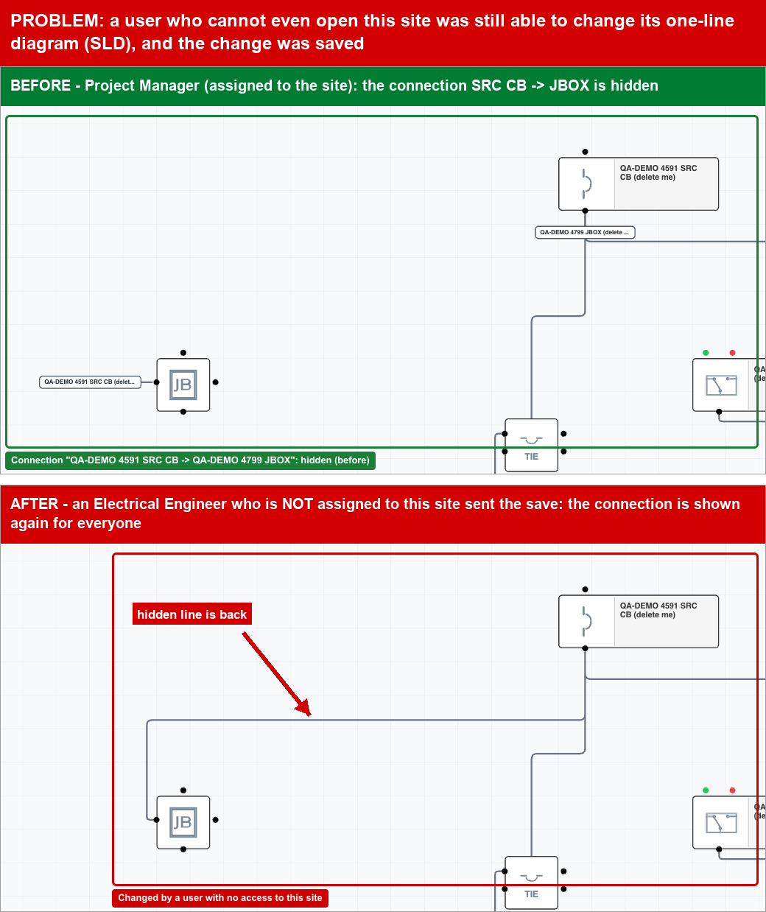

```
h3. Simple explanation
Every user only works on the sites (buildings) they are assigned to.
An Electrical Engineer who is NOT assigned to a site cannot pick that site in the app, and the app refuses to show its one-line diagram (SLD).
But the server still accepted that engineer's save requests for that site's diagram: it showed a hidden connection again, wrote a value into an asset and moved another asset.
All three changes were saved, and the Project Manager who owns the site then saw the changed diagram.
A normal user cannot do this by clicking in the app: it needs the same save requests the SLD editor sends, sent from the browser console.
It matters because anyone with an engineer login could change or break the diagram of a building they were never given, and the real users of that site would work with wrong data.
The server should refuse these saves for sites the user is not assigned to, the same way it already refuses to show them the diagram.

!ZP-4865-key-highlighted.png|width=720!

h3. Actual result
* For the Electrical Engineer (not assigned to the site) the server refuses to show the diagram (422 permission denied) but accepts changes to it (200).
* The changes are stored: after a reload the Project Manager sees the hidden connection as a full line again, the asset "QA-DEMO 4799 JBOX" carries the engineer's test value, and the asset "QA G-Meter" sits where the engineer moved it.

h3. Expected result
The server refuses every change to a site the user is not assigned to (422 / 403 permission denied), exactly as it refuses to read that site's diagram. Nothing is saved.

h3. Test data
* Environment: https://acme.qa.egalvanic.ai (QA)
* Site: "QA-DEMO ZP-4800 SLD canvas v2.4 (delete me)" (QA test site, id 363d5350-b42d-4e48-850f-b9f72d27ea08), SLD page https://acme.qa.egalvanic.ai/slds after picking the site in *Current site*
* Site owner (control): Project Manager abhiyant.singh+project@egalvanic.com (assigned to the site)
* User NOT assigned: Electrical Engineer abhiyant.singh+electric@egalvanic.com (customer user, not Egalvanic staff; 4 assigned sites, this site is not one of them)
* Connection "QA-DEMO 4591 SRC CB" → "QA-DEMO 4799 JBOX": id 30fcae76-8a1f-4530-a739-6199d9bf8471 (hidden before the test)
* Asset "QA-DEMO 4799 JBOX (delete me)": https://acme.qa.egalvanic.ai/assets/525225bf-4cf4-4c84-adcf-e270064425a3
* Asset "QA G-Meter" (moved with the "save positions" call): https://acme.qa.egalvanic.ai/assets/e77ee2e3-288d-497c-b8c6-748b61ec36eb
* QA build index-C14cwR0U.js, 13 Oct 2026 (first run 17:36 IST, re-checked by the QA audit the same day). Every value was put back after each test and checked.

h3. Steps to reproduce
1. Sign in as the Project Manager abhiyant.singh+project@egalvanic.com. In *Current site* pick "QA-DEMO ZP-4800 SLD canvas v2.4 (delete me)" and open *Site Data › SLD* (https://acme.qa.egalvanic.ai/slds). The connection "QA-DEMO 4591 SRC CB" → "QA-DEMO 4799 JBOX" is hidden: you see two short stubs with name tags and no line. (Screenshot 1)
!1-1-pm-sld-connection-hidden-before.png|width=720!
2. In a second browser (or a private window) sign in as the Electrical Engineer abhiyant.singh+electric@egalvanic.com. Click the *Current site* box and type "QA-DEMO ZP-4800": the app shows "No sites available", because this user is not assigned to the site. (Screenshot 2)
!1-2-ee-site-not-in-site-list.png|width=720!
3. Still as the Electrical Engineer, open the browser console (F12 › Console) and send the diagram read plus the two saves the SLD editor sends when a hidden connection is shown and when an asset is edited:
{noformat}
fetch('/api/sld/363d5350-b42d-4e48-850f-b9f72d27ea08/graph').then(r => console.log('read', r.status));
fetch('/api/edge/update/30fcae76-8a1f-4530-a739-6199d9bf8471', {method: 'PUT', headers: {'Content-Type': 'application/json'}, body: JSON.stringify({edge_manips: null})}).then(r => console.log('connection save', r.status));
fetch('/api/node/update/525225bf-4cf4-4c84-adcf-e270064425a3', {method: 'PUT', headers: {'Content-Type': 'application/json'}, body: JSON.stringify({node_manips: {qa_probe: 'EE-not-assigned'}})}).then(r => console.log('asset save', r.status));
{noformat}
4. The read is refused (422), but both saves answer 200. In the app the engineer still sees "The diagram couldn't be loaded". (Screenshot 3)
!1-3-ee-read-refused-but-writes-accepted.png|width=720!
5. Wait about 10 seconds, then reload the SLD page as the Project Manager. The connection is now a full line again (the engineer showed it), and the asset "QA-DEMO 4799 JBOX" now carries the engineer's test value {{qa_probe}}. (Screenshot 4)
!1-4-pm-sees-change-made-by-unassigned-ee.png|width=720!
6. Clean-up: as the Project Manager put both values back (connection hidden again, test value removed). (Screenshot 5)
!1-5-pm-restored-after-test.png|width=720!
7. The newer "save positions" call has the same gap. Before: asset "QA G-Meter" in its normal place (Screenshot 6). The Electrical Engineer cannot pick the site (Screenshot 7). After the engineer sends {{PUT /api/node/batch-positions}} with a new position for QA G-Meter, the Project Manager sees the asset moved (Screenshot 8). It was moved back afterwards.
!QA-13Oct-ZP-4621-x0-PASS-meter-in-normal-place-before.png|width=720!
!QA-13Oct-ZP-4621-x1-PASS-EE-cannot-pick-the-site.png|width=720!
!QA-13Oct-ZP-4621-x2-FAIL-asset-moved-by-unassigned-EE.png|width=720!

h3. Notes for the developer
* {{PUT /api/edge/update/<id>}}, {{PUT /api/node/update/<id>}} and {{PUT /api/node/batch-positions}} do not check the record's site against the user's assigned sites ({{accessible_sld_ids}}); {{GET /api/sld/<id>/graph}} does (422).
* The Electrical Engineer seat: is_eg_admin = false, role Electrical Engineer, has {{nodes.manage}} / {{edges.manage}}, 4 assigned sites, not this one.
* Saves sent without the direct-write header are applied about 9 seconds later, so check after a short wait.
* Also seen the same day: a Project Manager got 200 on {{PUT /api/node/update}} for an asset on a site they are not assigned to (no-change body).
* Related but different: ZP-4849 (SKM import to an unassigned site), ZP-4709 (Client Portal reads assets of unassigned sites), ZP-4621 (the batch-positions route). No ticket covers these update routes.
```

## ZP-4866

**Title:** [Web] Client Portal users can open the full Arc Flash Readiness page (with report export) by typing its address, although their menu hides it  
**Files to attach:** `ZP-4866-key-highlighted.png`

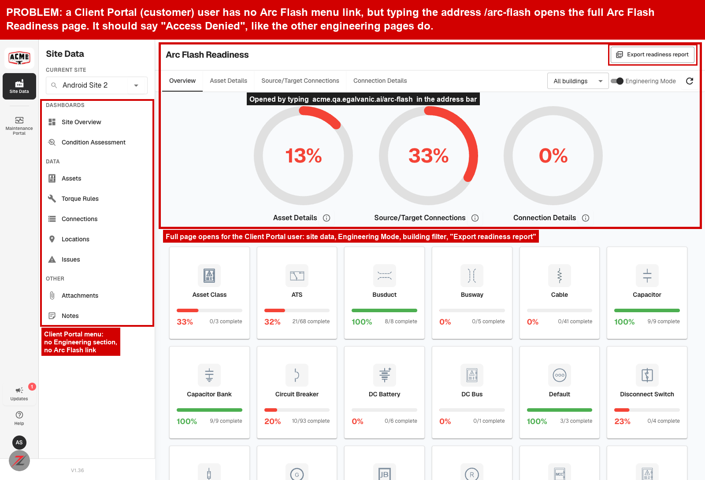

```
h3. Simple explanation
A Client Portal user is a customer contact who should only see the customer-facing pages.
Their menu correctly has no Engineering section and no "Arc Flash Readiness" link.
But if they type the page address (/arc-flash) into the browser, the full Arc Flash Readiness page opens.
They then see the site's readiness numbers per equipment class, the building filter, Engineering Mode and an "Export readiness report" button.
Other engineering pages, for example the SLD page, correctly show "Access Denied" when their address is typed.
They already see one headline number ("Arc Flash Readiness 13%") as a card on the Assets page; the problem is the full page and its report export.
It matters because the Client Portal role is not given permission for this page, so customers get engineering detail and an export they are not meant to have.
Typing /arc-flash should show "Access Denied" (or send them back), like the other engineering pages.

!ZP-4866-key-highlighted.png|width=720!

h3. Actual result
As the Client Portal user, typing https://acme.qa.egalvanic.ai/arc-flash opens the full Arc Flash Readiness page with real site data: the 13% / 33% / 0% gauges, the per-class cards, the building filter, Engineering Mode and "Export readiness report". The report window also opens.

h3. Expected result
Typing /arc-flash is refused for the Client Portal user ("Access Denied" or a redirect), the same as typing /slds and /equipment-designations. The page is only for roles that have the arc-flash view permission.

h3. Test data
* Environment: https://acme.qa.egalvanic.ai (QA)
* Client Portal user: abhiyant.singh+clientportal@egalvanic.com (role Client Portal, customer user, not Egalvanic staff; does not have the arc-flash view permission)
* Site: "Android Site 2" (picked in *Current site*)
* Address typed: https://acme.qa.egalvanic.ai/arc-flash
* Controls typed by the same user: https://acme.qa.egalvanic.ai/slds and https://acme.qa.egalvanic.ai/equipment-designations (both "Access Denied")
* Headline card: Site Data › Assets, https://acme.qa.egalvanic.ai/assets
* Super Admin control: abhiyant.singh+admin@egalvanic.com (menu has "Arc Flash Readiness")
* QA build index-C14cwR0U.js, re-checked 13 Oct 2026: still reproduces

h3. Steps to reproduce
1. Sign in to https://acme.qa.egalvanic.ai as the Client Portal user abhiyant.singh+clientportal@egalvanic.com and pick site "Android Site 2". The left menu has only "Site Data" and "Maintenance Portal": no Engineering section and no "Arc Flash Readiness" link. (Screenshot 1)
!2-1-cp-menu-has-no-engineering.png|width=720!
2. Control, same user: type https://acme.qa.egalvanic.ai/slds (another engineering page) in the address bar. It is correctly refused with "Access Denied". (Screenshot 2)
!2-2-control-cp-typed-slds-access-denied.png|width=720!
3. Now type https://acme.qa.egalvanic.ai/arc-flash in the address bar. The full Arc Flash Readiness page opens: the gauges, the per-class cards with real numbers, the building filter, Engineering Mode and the "Export readiness report" button. (Screenshot 3)
!2-3-cp-typed-arc-flash-page-opens.png|width=720!
4. Click "Export readiness report": the report window opens for the Client Portal user too (not submitted in this test). (Screenshot 4)
!2-4-cp-export-readiness-report-window.png|width=720!
5. Control: a Super Admin has an Engineering menu with "Arc Flash Readiness"; the page is meant for roles that have it. (Screenshot 5)
!2-5-control-super-admin-menu-has-arc-flash.png|width=720!
6. For context: on *Site Data › Assets* the Client Portal user already sees the headline card "Arc Flash Readiness 13% — 261 of 2048 fields • 4 unclassified" (Screenshot 6). Clicking that card does not open the page for this user (Screenshot 7). So the headline number is meant to be visible; the bug is the full page and its export.
!D4-4866-cp-assets-page-cards.png|width=720!
!D5-4866-cp-click-assets-arc-card.png|width=720!

h3. Notes for the developer
* The route guard table has /arc-flash with {{features.arc_flash.view}}, but /arc-flash is also in the layout's direct-render list (pathname check), so the permission check is skipped. /slds and /equipment-designations are guarded correctly.
* While the page is open as the Client Portal user, {{/api/lookup/nodes/<site>}}, {{/api/sld/<site>/edges}} and {{/api/sld/<site>/library-designations}} all answer 200.
* Related: ZP-4699 (removed Engineering surfaces from the Client Portal); it did not cover the /arc-flash route.
```

## ZP-4868

**Title:** [Web] Work order forms: in a multi-pick list, every tick clears the search text, so picking several people means typing the search again each time  
**Files to attach:** `ZP-4868-key-highlighted.png`, `ZP-4868-expected-mockup.png`

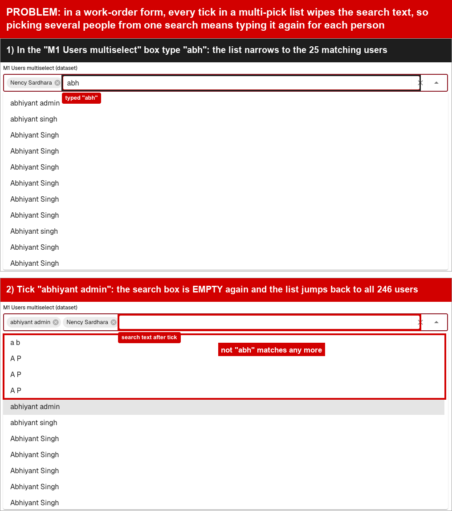

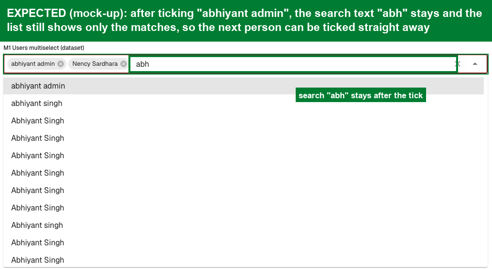

```
h3. Simple explanation
Some work-order forms have a field where you pick several people from the company's user list.
You can type a few letters to narrow the list, for example "abh".
But each time you tick one person, the typed text disappears and the list jumps back to all 246 users.
So to pick three people who match the same search, you have to type the search three times.
Nothing is lost: the people you picked stay picked. It is a usability problem (Low).
The feature this belongs to (ZP-4753) is meant for exactly this: "tick several filtered options".
After a tick, the search text should stay until the user clears it.

!ZP-4868-key-highlighted.png|width=720!
!ZP-4868-expected-mockup.png|width=720!

h3. Actual result
After ticking one match, the search box is empty and the list shows all 246 users again. To tick the next "abh" user, "abh" has to be typed again.

h3. Expected result
The search text ("abh") and the filtered list stay after each tick, so several matches can be ticked one after another. The text clears only when the user clears it or closes the list.

h3. Test data
* Environment: https://acme.qa.egalvanic.ai (QA)
* Role / login: Project Manager, abhiyant.singh+project@egalvanic.com
* Work order "QA-DEMO ZP-4801 Tuned column (delete me)": https://acme.qa.egalvanic.ai/sessions/22a22b9c-4eda-43ed-b131-4b7146912441 › More › Forms › row "13N-H1-1"
* Form "QA-DEMO ZP-4751 ZP-4753 dataset type-to-search (delete me)", field "M1 Users multiselect (dataset)"
* Search text "abh" gives 25 matches out of 246 users
* QA build index-C14cwR0U.js, 13 Oct 2026 (17:51 IST), re-checked by the QA audit the same day. Nothing was saved.

h3. Steps to reproduce
1. Sign in to https://acme.qa.egalvanic.ai as the Project Manager abhiyant.singh+project@egalvanic.com. Open work order "QA-DEMO ZP-4801 Tuned column (delete me)" (https://acme.qa.egalvanic.ai/sessions/22a22b9c-4eda-43ed-b131-4b7146912441), click *More › Forms* and open the asset row "13N-H1-1". Find the field "M1 Users multiselect (dataset)". (Screenshot 1)
!4-1-wo-form-multiselect-field.png|width=720!
2. Click into M1 and type "abh": the list narrows to the 25 matching users. (Screenshot 2)
!4-2-typed-abh-matches.png|width=720!
3. Tick one match, for example "abhiyant admin". It is added as a chip, but the search box is now empty again and the list jumps back to all 246 users. (Screenshot 3)
!4-3-after-tick-search-cleared-full-list.png|width=720!
4. To tick a second "abh" user you must type "abh" again. Every extra pick from the same search costs a full re-type. (Screenshot 4)
!4-4-must-retype-for-next-pick.png|width=720!
5. Close the form without saving.

h3. Notes for the developer
* Same behaviour on all dataset multi-pick fields (users, test equipment).
* The MUI Autocomplete (multiple + disableCloseOnSelect) resets {{inputValue}} on select. Keep it controlled ({{inputValue}} / {{onInputChange}}) and ignore reason "reset".
* Belongs to the same feature as ZP-4753 (whose QA Review says "Tick several filtered options"). No existing ticket found (searched dataset / multiselect / type-to-search).
```

## ZP-4869

**Title:** [Web] SLD PDF export: the "TO …" name tag of a hidden connection is printed under the asset symbol at a left-side terminal, so the name cannot be read  
**Files to attach:** `ZP-4869-key-highlighted.png`, `ZP-4869-expected-mockup.png`

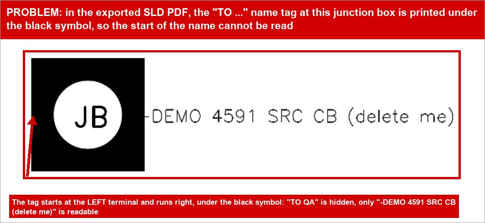

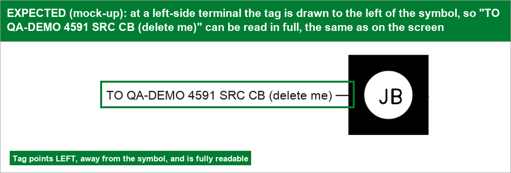

```
h3. Simple explanation
On the one-line diagram (SLD) a connection line can be hidden to keep the drawing tidy.
Each end of a hidden connection then shows a short stub with a name tag, "TO <the other asset>".
On screen these tags are drawn correctly.
When the diagram is exported to PDF, a tag on the LEFT side of an asset is printed running to the right, under the asset's black symbol.
So the start of the name is covered: the tag reads "-DEMO 4591 SRC CB (delete me)" instead of "TO QA-DEMO 4591 SRC CB (delete me)".
The tag at the other end of the same connection prints fine.
It matters because the PDF is what customers and field crews print and use; a cut-off tag means they cannot tell where the hidden connection goes.
The tag should point away from the asset and be fully readable, as it is on screen.

!ZP-4869-key-highlighted.png|width=720!
!ZP-4869-expected-mockup.png|width=720!

h3. Actual result
In the exported PDF the tag at the junction box's left terminal starts under the black "JB" symbol, so "TO QA" is hidden and only "-DEMO 4591 SRC CB (delete me)" can be read.

h3. Expected result
At a left-side terminal the tag is drawn to the left, away from the symbol, and the whole text "TO QA-DEMO 4591 SRC CB (delete me)" is readable, the same as on the canvas.

h3. Test data
* Environment: https://acme.qa.egalvanic.ai (QA)
* Role / login: Project Manager, abhiyant.singh+project@egalvanic.com
* Site: "QA-DEMO ZP-4800 SLD canvas v2.4 (delete me)" (QA test site, id 363d5350-b42d-4e48-850f-b9f72d27ea08), SLD page https://acme.qa.egalvanic.ai/slds after picking the site in *Current site*
* Hidden connection "QA-DEMO 4591 SRC CB" → "QA-DEMO 4799 JBOX": id 30fcae76-8a1f-4530-a739-6199d9bf8471
* Asset "QA-DEMO 4799 JBOX (delete me)": https://acme.qa.egalvanic.ai/assets/525225bf-4cf4-4c84-adcf-e270064425a3
* Export settings: Export Entire SLD, ARCH-D (defaults); file "sld-export-2026-10-13.pdf"
* QA build index-C14cwR0U.js, 13 Oct 2026 (18:02 IST), re-checked by the QA audit the same day with a fresh export

h3. Steps to reproduce
1. Sign in as the Project Manager abhiyant.singh+project@egalvanic.com. Pick site "QA-DEMO ZP-4800 SLD canvas v2.4 (delete me)" and open *Site Data › SLD* (https://acme.qa.egalvanic.ai/slds). The connection "QA-DEMO 4591 SRC CB" → "QA-DEMO 4799 JBOX" is hidden. On the canvas the tag at the JBOX left terminal points LEFT and is fully readable. (Screenshot 1)
!5-1-canvas-hidden-connection-tag-readable.png|width=720!
2. Click *Export* (bottom toolbar), then *Export PDF*. (Screenshot 2)
!5-2-export-menu-export-pdf.png|width=720!
3. In the window click *Export Entire SLD*. (Screenshot 3)
!5-3-export-pdf-dialog.png|width=720!
4. Keep the defaults (ARCH-D) and click *Generate PDF*. The export takes about 20 seconds. (Screenshot 4)
!5-3b-export-pdf-options.png|width=720!
5. Open the downloaded PDF and zoom to the JBOX. The tag starts at the left terminal and runs right, across the filled black symbol, so "TO QA" is hidden and it reads "-DEMO 4591 SRC CB (delete me)". (Screenshot 5)
!5-4-pdf-left-terminal-tag-covered-by-symbol.png|width=720!
6. Control, same PDF: at the other end (SRC CB, bottom terminal) the tag "TO QA-DEMO 4799 JBOX (delete me)" is clear of the symbol and fully readable. Only the left-terminal tag is covered. (Screenshot 6)
!5-5-pdf-control-other-end-tag-readable.png|width=720!

h3. Notes for the developer
* The PDF export (backend) places the "TO …" tag at a fixed right-of-terminal offset, whatever side of the asset the terminal is on. The canvas already flips it for left terminals.
* The JBOX moved on the sheet since the first run because other testers changed the diagram; the defect is identical.
* Belongs to the same feature as ZP-4800 (hide / show connections). No existing ticket (ZP-3839 is about label size, a different problem).
```

## ZP-4870

**Title:** [Web] Form builder preview (Web View): fields that list the company's users show no names, so form authors cannot try them (Test Equipment fields work)  
**Files to attach:** `ZP-4870-key-highlighted.png`, `ZP-4870-expected-mockup.png`

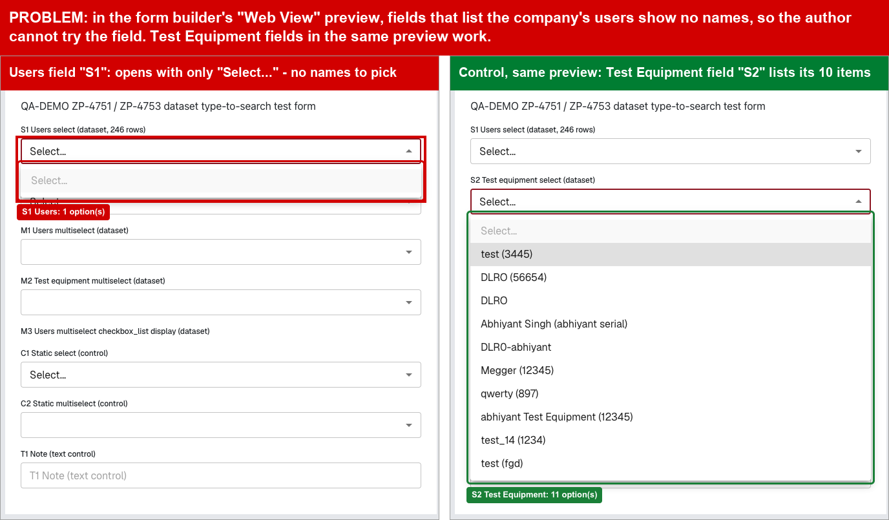

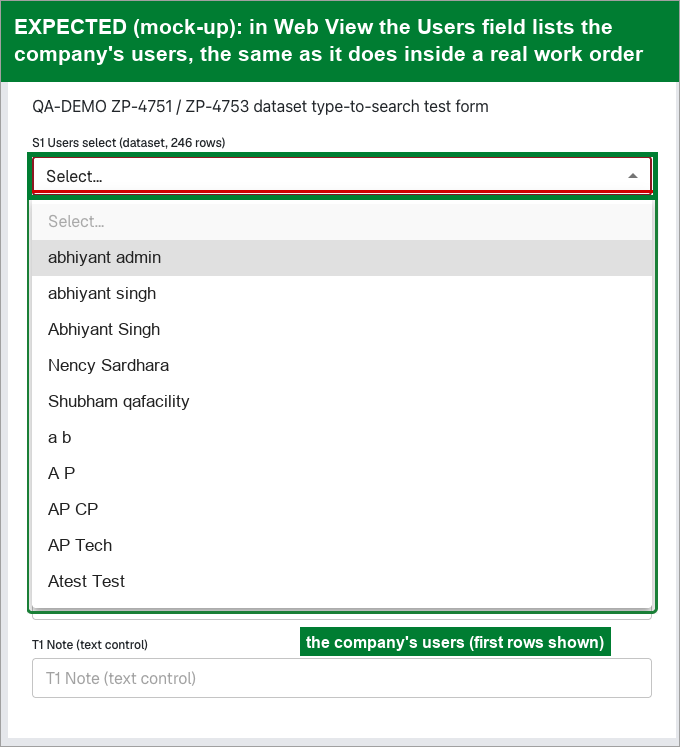

```
h3. Simple explanation
Form authors build forms in *Builder › Forms* and check them in the "Web View" preview before the forms are used on work orders.
Some fields take their choices from the company's list of users, for example "pick the technician".
In the preview these fields show no names at all, only "Select...".
In the same preview, fields that take their choices from the Test Equipment list do show their 10 items, so the preview can load lists; only the users list is missing.
The same users field works fine inside a real work order, so filled-in forms are not affected (Low).
It matters because authors cannot check how a user field looks or behaves before they publish the form.
The preview should list the users, the same as a real work order does.

!ZP-4870-key-highlighted.png|width=720!
!ZP-4870-expected-mockup.png|width=720!

h3. Actual result
In Web View, "S1 Users select (dataset, 246 rows)" opens with only "Select..." and "M1 Users multiselect (dataset)" has 0 options. "S2 Test equipment select (dataset)" in the same preview lists 10 items.

h3. Expected result
Users-list fields show the company's users in Web View, the same as in a real work order and the same way Test Equipment fields already do.

h3. Test data
* Environment: https://acme.qa.egalvanic.ai (QA)
* Role / login: Super Admin, abhiyant.singh+admin@egalvanic.com (form builder access)
* Forms page: https://acme.qa.egalvanic.ai/eg-forms
* Form: "QA-DEMO ZP-4751 ZP-4753 dataset type-to-search (delete me)" (QA test form)
* Real-form control: work order "QA-DEMO ZP-4801 Tuned column (delete me)", https://acme.qa.egalvanic.ai/sessions/22a22b9c-4eda-43ed-b131-4b7146912441 › More › Forms › 13N-H1-1
* QA build index-C14cwR0U.js, re-checked 13 Oct 2026. Nothing was saved (the form was only opened).

h3. Steps to reproduce
1. Sign in to https://acme.qa.egalvanic.ai as the Super Admin abhiyant.singh+admin@egalvanic.com. Go to *Builder › Forms* (https://acme.qa.egalvanic.ai/eg-forms), search "QA-DEMO ZP-4751" and open "QA-DEMO ZP-4751 ZP-4753 dataset type-to-search (delete me)". (Screenshot 1)
!6-1-eg-forms-list-test-form.png|width=720!
2. Click the pencil *Edit Form*, then *Web View*. (Screenshot 2)
!6-2-builder-web-view-preview.png|width=720!
3. Open "S1 Users select (dataset, 246 rows)": only "Select..." is listed. Open "M1 Users multiselect (dataset)": 0 options. (Screenshot 3)
!4870-1-web-view-users-select-empty.png|width=720!
4. Control, same preview: open "S2 Test equipment select (dataset)". It lists the company's 10 test-equipment items ("test (3445)", "DLRO (56654)", …). (Screenshot 4)
!4870-2-control-web-view-test-equipment-loads.png|width=720!
5. Control, real form: the same S1 field inside work order "QA-DEMO ZP-4801 Tuned column (delete me)" (https://acme.qa.egalvanic.ai/sessions/22a22b9c-4eda-43ed-b131-4b7146912441) › *More › Forms › 13N-H1-1* lists all 246 users with a "Type to search" box. (Screenshot 5)
!6-4-control-wo-form-same-field-lists-users.png|width=720!

h3. Notes for the developer
* The builder's preview list loader (EGFormBuilderV2) only knows the {{test_equipment}} source; the work-order renderer (EGFormRendererV2) also has {{users}} → {{/eg-form-sources/users}}.
* The builder's "Options source" picker offers only Test Equipment and Linked Asset, so a Users-list field cannot be created in the web builder today; this test form was built through the API. Worth fixing together.
* Found while testing ZP-4751.
```

## ZP-4871

**Title:** [Web] Work order Forms tab: two different forms that have no form key are listed under one form's name, so users open the wrong form  
**Files to attach:** `ZP-4871-key-highlighted.png`, `ZP-4871-expected-mockup.png`

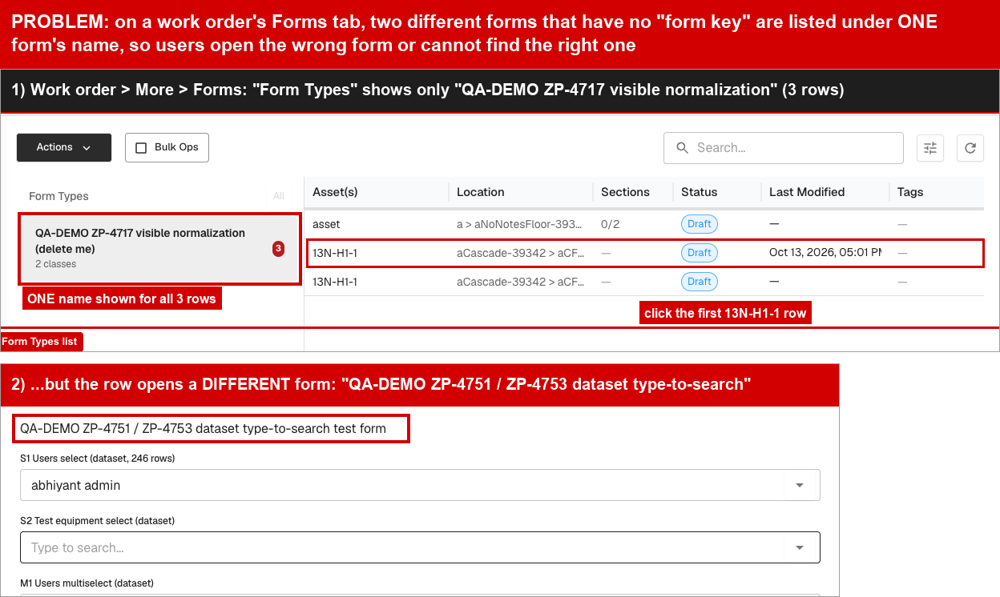

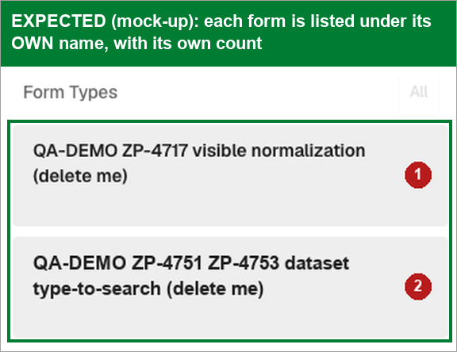

```
h3. Simple explanation
A work order's Forms tab has a "Form Types" list on the left that groups the work order's forms by form.
It groups them by an internal "form key", and some forms have no key.
When a work order holds two different forms that both have no key, the list shows them under ONE name: the first form's name.
In our test work order three rows appear under "QA-DEMO ZP-4717 visible normalization", but two of them are really a different form, and clicking one opens that other form.
This is not only test data: on Acme QA 40 of 658 forms have no key, and 33 of those are real (not QA-DEMO) forms.
It matters because users look for a form by its name, so they open or fill the wrong form, or cannot find the right one.
Each form should be listed under its own name.

!ZP-4871-key-highlighted.png|width=720!
!ZP-4871-expected-mockup.png|width=720!

h3. Actual result
"Form Types" shows ONE entry, "QA-DEMO ZP-4717 visible normalization (delete me)", with 3 rows. The 3 rows come from 2 different forms, and the first "13N-H1-1" row opens "QA-DEMO ZP-4751 / ZP-4753 dataset type-to-search", not the form named in the list.

h3. Expected result
"Form Types" groups by the form itself (its id), not by its key. Forms without a key each show their own name and their own count, and are never merged under another form's name.

h3. Test data
* Environment: https://acme.qa.egalvanic.ai (QA)
* Role / login: Project Manager, abhiyant.singh+project@egalvanic.com
* Work order "QA-DEMO ZP-4801 Tuned column (delete me)": https://acme.qa.egalvanic.ai/sessions/22a22b9c-4eda-43ed-b131-4b7146912441 › More › Forms
* Forms on it (both without a key): "QA-DEMO ZP-4717 visible normalization (delete me)" (1 row, form id e293697b…) and "QA-DEMO ZP-4751 ZP-4753 dataset type-to-search (delete me)" (2 rows, form id dc24bb98…)
* Forms list for the control: https://acme.qa.egalvanic.ai/eg-forms
* QA build index-C14cwR0U.js, re-checked 13 Oct 2026: still reproduces

h3. Steps to reproduce
1. Sign in to https://acme.qa.egalvanic.ai as the Project Manager abhiyant.singh+project@egalvanic.com. Open work order "QA-DEMO ZP-4801 Tuned column (delete me)" (https://acme.qa.egalvanic.ai/sessions/22a22b9c-4eda-43ed-b131-4b7146912441) and click *More › Forms*.
2. "Form Types" shows ONE name, "QA-DEMO ZP-4717 visible normalization (delete me)", with 3 rows under it. (Screenshot 1)
!7-1-wo-forms-tab-one-form-type.png|width=720!
3. Click the first "13N-H1-1" row. The form that opens is "QA-DEMO ZP-4751 / ZP-4753 dataset type-to-search", a different form from the one named in the list. (Screenshot 2)
!7-2-row-opens-a-different-form.png|width=720!
4. Control: in *Builder › Forms* (https://acme.qa.egalvanic.ai/eg-forms) search "QA-DEMO ZP-47". These are two separate forms. (Screenshot 3)
!7-3-control-two-separate-forms-in-builder.png|width=720!

h3. Notes for the developer
* The "Form Types" list keys each group by {{eg_form_key}}; when it is null for several forms they collapse into one group labelled with the first form's title.
* Real-world reach: 40 of 658 forms on Acme QA have no key, 33 of them real (e.g. "Untitled Form" x4, "70B-DA", "Test eg form 1"). Any of them can be added to an asset on a work order (the Add form picker uses the form id, not the key), so a real work order can end up with two keyless forms.
* No existing ticket (ZP-3880 fixed a related null-key rules-matching bug in a different place).
```

## ZP-4876

**Title:** [Web] SKM import: re-importing an unchanged SKM export silently changes the class of existing assets (12 of 94 on the test site, e.g. PDU → Panelboard, Lightning Arrester → Load)  
**Files to attach:** `ZP-4876-key-highlighted.png`

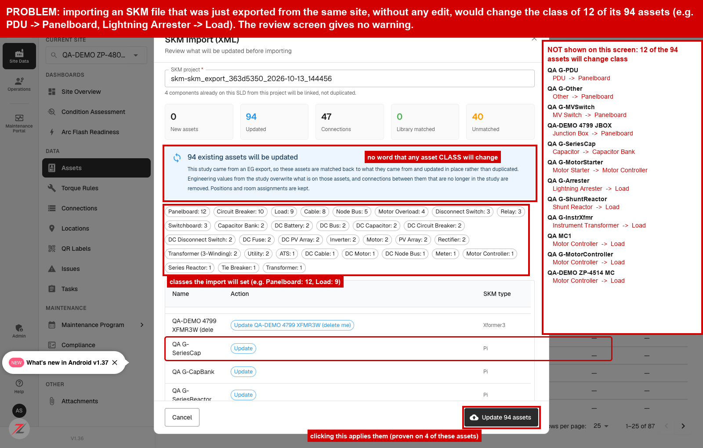

```
h3. Simple explanation
Engineers can export a site's equipment to an SKM file (for the SKM power-study software), change values there, and import the file back.
We exported a test site and imported the same file straight back, without changing anything.
The review screen says 94 assets will be updated, and the import would also change the class (equipment type) of 12 of them, for example PDU → Panelboard and Lightning Arrester → Load.
The screen gives no warning about this; it only says engineering values will be overwritten.
On 4 of these assets we confirmed that clicking Update really changes the class (they were put back afterwards).
It matters because the class decides the asset's symbol, forms and maintenance plan, so a normal "export, fix a value, import back" round trip would quietly change equipment data on a customer site.
An unchanged file should change nothing, or the review should clearly list each class change and let the user keep the current class.

!ZP-4876-key-highlighted.png|width=720!

h3. Actual result
The review of the unchanged full export says "94 Updated" and *Update 94 assets*, with class chips such as "Panelboard: 12" and "Load: 9". Compared with today's classes, 12 assets would get a different class (table in step 5). There is no "class will change" warning.

h3. Expected result
An unchanged round trip changes nothing. When an imported row matches an existing asset (by Alternate UID), the asset keeps its class, or the review lists every "class will change from X to Y" and lets the user keep the current class.

h3. Test data
* Environment: https://acme.qa.egalvanic.ai (QA)
* Role / login: Project Manager, abhiyant.singh+project@egalvanic.com
* Site: "QA-DEMO ZP-4800 SLD canvas v2.4 (delete me)" (QA test site, id 363d5350-b42d-4e48-850f-b9f72d27ea08); SLD page https://acme.qa.egalvanic.ai/slds, assets page https://acme.qa.egalvanic.ai/assets
* Example assets: QA G-SeriesCap https://acme.qa.egalvanic.ai/assets/42e71131-76df-4a4b-9801-704528e46752 , QA G-MotorStarter https://acme.qa.egalvanic.ai/assets/6d5983e2-7bf7-4e7a-8766-23f00e155b54 , QA G-PDU https://acme.qa.egalvanic.ai/assets/a6921488-7464-4a06-b3e8-6b00a4c620f9 , QA G-Arrester https://acme.qa.egalvanic.ai/assets/02ec9b8a-7ea9-43b9-92e3-4ea684c25b65
* SKM project of the full export: "skm-skm_export_363d5350_2026-10-13_144456" (94 components)
* QA build index-C14cwR0U.js, re-checked 13 Oct 2026. Preview only with the full file (nothing committed); commit proven earlier on 13 Oct on a 4-asset cut of the export, then reverted.

h3. Steps to reproduce
1. Sign in to https://acme.qa.egalvanic.ai as the Project Manager abhiyant.singh+project@egalvanic.com. Pick site "QA-DEMO ZP-4800 SLD canvas v2.4 (delete me)". Open *Site Data › Assets* and note the classes: QA G-SeriesCap = *Capacitor*, QA G-MotorStarter = *Motor Starter*, QA G-PDU = *PDU*, QA G-Arrester = *Lightning Arrester*. (Screenshots 1 and 2 show some of these assets on the SLD before any import.)
!QA-13Oct-ZP-4603-2-PASS-instrument-xfmr-capbank-relay-meter.png|width=720!
!QA-13Oct-ZP-4603-7-PASS-pdu-panelboard-other-boxed-switches.png|width=720!
2. Open the SLD page (https://acme.qa.egalvanic.ai/slds), click *Export › Export Engineering XML*, confirm, and save the file. Do not open or edit it.
3. Go to *Site Data › Assets › SKM › Import (Full)*, choose that file and click *Analyze*.
4. The review says "94 Updated", "94 existing assets will be updated", and the button reads *Update 94 assets*. The class chips above the table count the classes the import will set (e.g. "Panelboard: 12", "Load: 9", "Capacitor Bank: 2"). There is no "class will change" warning; the banner only says engineering values will be overwritten. (Screenshot 3)
!4876-1-full-export-reimport-review.png|width=720!
5. Comparing the class the preview gives each asset with its current class shows these 12 changes (the other 82 assets keep their class):
||Asset||Class now||Class after re-import||SKM type||
|QA G-PDU, QA G-Other, QA G-MVSwitch, QA-DEMO 4799 JBOX (delete me)|PDU, Other, MV Switch, Junction Box|Panelboard|Bus|
|QA G-SeriesCap|Capacitor|Capacitor Bank|Pi|
|QA G-MotorStarter|Motor Starter|Motor Controller|MotorController|
|QA G-Arrester, QA G-ShuntReactor, QA G-InstrXfmr|Lightning Arrester, Shunt Reactor, Instrument Transformer|Load|Load|
|QA MC1, QA G-MotorController, QA-DEMO ZP-4514 MC (delete me)|Motor Controller|Load|Load|
6. QA did NOT click *Update 94 assets* with the full file (it would change data on the site). The class change on commit was proven earlier the same day with a 4-asset cut of this export: the review said *Update 4 assets* (Screenshot 4), and after the update QA G-SeriesCap, QA G-MotorStarter and QA G-PDU had the new classes (Screenshot 5). Those 4 assets were then put back.
!QA-13Oct-ZP-4603-x1-FAIL-skm-reimport-review-unchanged-export.png|width=720!
!QA-13Oct-ZP-4603-x2-FAIL-after-reimport-classes-changed.png|width=720!

h3. Notes for the developer
* Several EG classes share one SKM type (Pi, Bus, Load, MotorController), and on update the importer writes its default class for that type over the existing class.
* The export dialog lists "unconfigured classes" and the SKM guidance says unmapped classes import "as generic loads", but nothing says a re-import onto matched existing assets overwrites their class.
* Found while testing ZP-4603 (which passes); not caused by that ticket. Related: ZP-2689 (SKM export class mapping defaults), ZP-4854 (Bulk Edit round trip).
```

## ZP-4880

**Title:** [Web] Asset › Maintenance › Add Service History: a future "Last serviced" date shows a raw technical error instead of a plain message (and the date box allows future dates)  
**Files to attach:** `ZP-4880-key-highlighted.png`, `ZP-4880-expected-mockup.png`

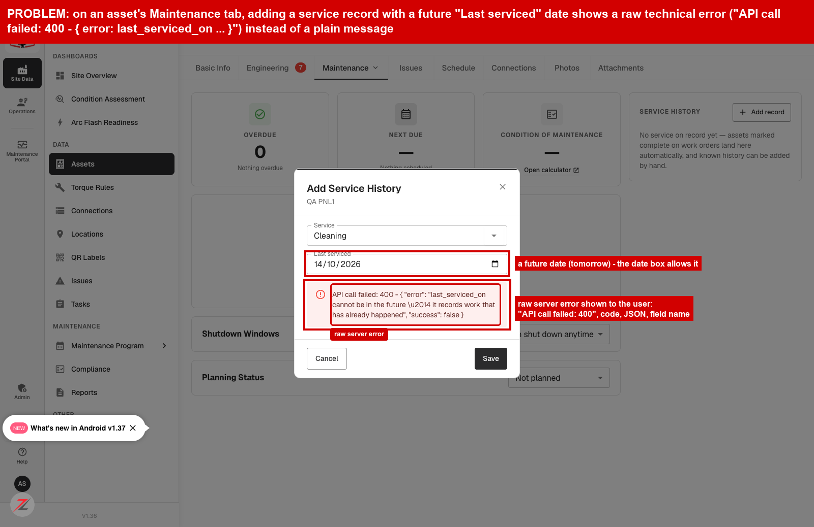

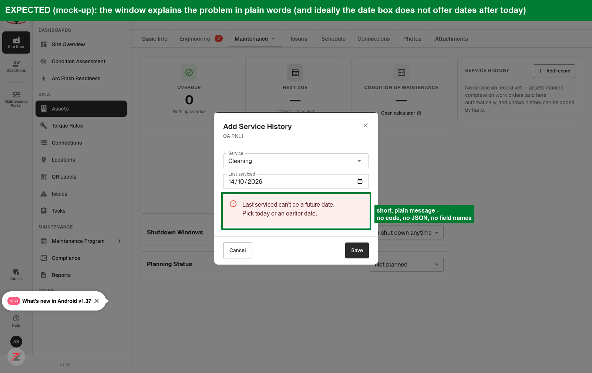

```
h3. Simple explanation
On an asset's Maintenance tab, a user can add a past service to the asset's service history, for example "Cleaning on 10 Oct".
The "Last serviced" date box lets the user pick a date in the future.
When they click Save, the server correctly refuses the future date, but the window shows the raw technical reply: "API call failed: 400 - ..." with computer text (JSON), an internal field name and a code instead of a dash.
The user is not told in plain words what is wrong or what to do.
It matters because customers see an error that looks like the app is broken, and may not understand that only the date is wrong.
The date box should not offer future dates, and if one is still sent the window should show a short message such as "Last serviced can't be a future date. Pick today or an earlier date."

!ZP-4880-key-highlighted.png|width=720!
!ZP-4880-expected-mockup.png|width=720!

Video: [^future_date_infrared.mov]

h3. Actual result
The date box accepts tomorrow's date. After *Save* the red box in the window shows:
{noformat}
API call failed: 400 - { "error": "last_serviced_on cannot be in the future — it records work that has already happened", "success": false }
{noformat}
Nothing is saved (correct), but the message is the raw server reply.

h3. Expected result
* The date box does not allow dates after today (or turns red as soon as a future date is picked).
* If a future date is still sent, the window shows a short, plain message under the date, for example: *"Last serviced can't be a future date. Pick today or an earlier date."*
* Users never see "API call failed", the status code, JSON or field names.

h3. Test data
* Environment: https://acme.qa.egalvanic.ai (QA)
* Role / login: Project Manager, abhiyant.singh+project@egalvanic.com (customer user)
* Site: "QA-DEMO ZP-4800 SLD canvas v2.4 (delete me)" (QA test site)
* Asset "QA PNL1": https://acme.qa.egalvanic.ai/assets/4b84bf4a-ad24-4c31-944d-5d65ba29a846
* Also reproduced as Super Admin (abhiyant.singh+admin@egalvanic.com) on asset "FDR-Circuit Breaker-3": https://acme.qa.egalvanic.ai/assets/713ff57d-288d-47b3-b7b4-ef12958f0b9c (a Project Manager cannot open this one)
* Values: Service = Cleaning, Last serviced = tomorrow (14/10/2026 when tested on 13 Oct)
* QA build index-C14cwR0U.js, re-checked 13 Oct 2026. Save returned 400, so nothing was stored.

h3. Steps to reproduce
1. Sign in to https://acme.qa.egalvanic.ai as the Project Manager abhiyant.singh+project@egalvanic.com. In *Current site* choose "QA-DEMO ZP-4800 SLD canvas v2.4 (delete me)".
2. Go to *Site Data › Assets*, search "QA PNL1" and open it (https://acme.qa.egalvanic.ai/assets/4b84bf4a-ad24-4c31-944d-5d65ba29a846).
3. Click the *Maintenance* tab. On the right, under *Service history*, click *+ Add record*. (Screenshot 1: the same tab, shown on asset FDR-Circuit Breaker-3)
!1-asset-maintenance-tab-add-record.png|width=720!
4. In *Add Service History* pick Service = *Cleaning*. (Screenshot 2)
!2-add-service-history-dialog.png|width=720!
5. In *Last serviced* pick tomorrow's date. The date box accepts it: future days are not greyed out.
6. Click *Save*. The red box shows the raw server error. (Screenshot 3: Project Manager on QA PNL1; Screenshot 4: first run; Screenshot 5: close-up)
!4880-3-pm-customer-seat-same-raw-error.png|width=720!
!3-future-date-shows-raw-api-error.png|width=720!
!4-raw-api-error-close-up.png|width=720!

h3. Notes for the developer
* The server check is correct (a future date must be refused); only the way the error is shown is wrong.
* The *Last serviced* box is a plain date input with no max date: set max = today and map this 400 ({{PUT /api/asset-maintenance/node/<id>/history}}) to a field message.
* Same kind of issue as ZP-4730, ZP-4714 and ZP-4412 (raw "API call failed" text shown to users). The asset FDR-Circuit Breaker-3 is a Cable-class asset despite its name.
```

## ZP-4882

**Title:** [Web] SLD Issues list calls an Inverter and a Rectifier a "Transformer" ("no secondary winding voltage"): wrong, confusing wording  
**Files to attach:** `ZP-4882-key-highlighted.png`, `ZP-4882-expected-mockup.png`

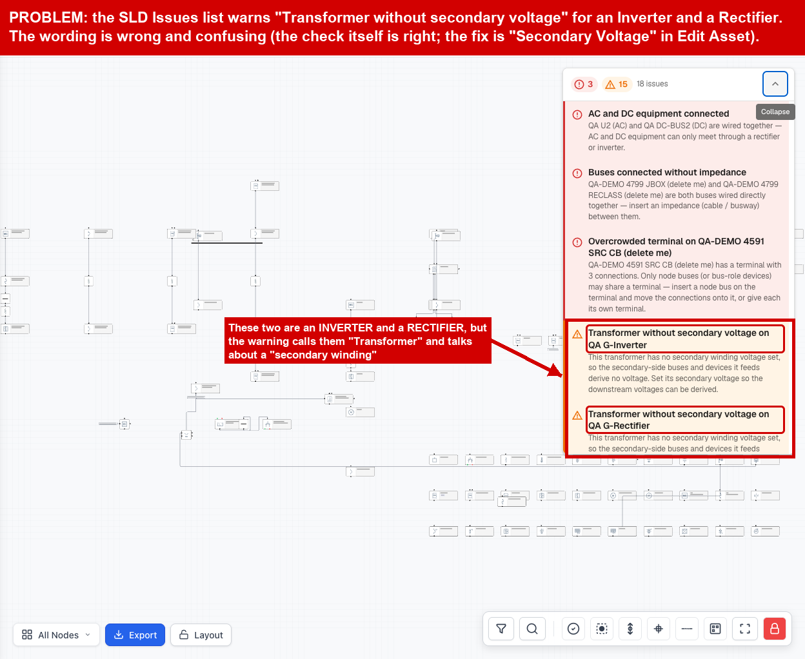

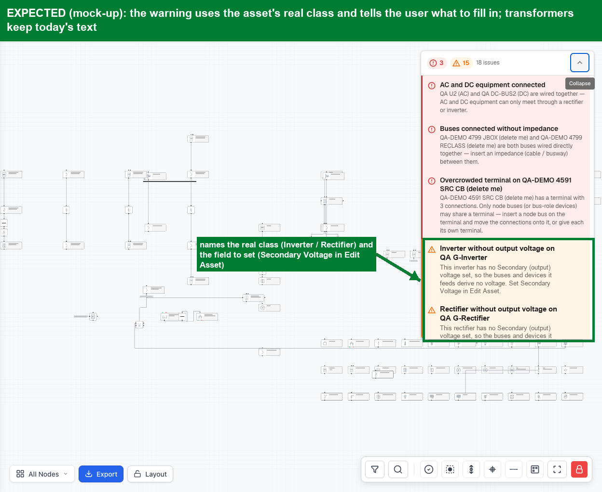

```
h3. Simple explanation
The one-line diagram (SLD) page has an Issues list that warns about missing engineering data.
For an Inverter and a Rectifier it says "Transformer without secondary voltage" and "This transformer has no secondary winding voltage set".
These assets are not transformers, so the message is confusing: users may think the asset has the wrong class or the check is broken.
The check itself is right: these assets do need a Secondary Voltage, and the user can set it in *Edit Asset*, which clears the warning.
So only the wording is wrong (Low).
The warning should name the real class and say what to fill in, for example "Inverter without output voltage on QA G-Inverter: set Secondary Voltage in Edit Asset". Transformers keep today's text.

!ZP-4882-key-highlighted.png|width=720!
!ZP-4882-expected-mockup.png|width=720!

h3. Actual result
The Issues list shows "Transformer without secondary voltage on QA G-Inverter" (also on QA G-Rectifier, QA INV1 and QA REC1), with the text "This transformer has no secondary winding voltage set…".

h3. Expected result
For inverters and rectifiers the warning uses the real class and the real field name, e.g. "Inverter without output voltage on QA G-Inverter: set Secondary Voltage in Edit Asset" and "Rectifier without output voltage on QA G-Rectifier: …". Transformers keep today's text.

h3. Test data
* Environment: https://acme.qa.egalvanic.ai (QA)
* Role / login: Project Manager, abhiyant.singh+project@egalvanic.com
* Site: "QA-DEMO ZP-4800 SLD canvas v2.4 (delete me)" (QA test site, id 363d5350-b42d-4e48-850f-b9f72d27ea08), SLD page https://acme.qa.egalvanic.ai/slds (18 issues when tested)
* Assets: QA G-Inverter https://acme.qa.egalvanic.ai/assets/f556e269-32c7-4ae2-a8bb-7ec880304dae , QA G-Rectifier https://acme.qa.egalvanic.ai/assets/6f55b9d6-a566-4f79-a24c-5617316cf386 , QA INV1 https://acme.qa.egalvanic.ai/assets/53e2a78e-4228-41e4-a025-8b5a3add37fb , QA REC1 https://acme.qa.egalvanic.ai/assets/a4cc9a36-c88d-4798-9338-850c7236beb7
* QA build index-C14cwR0U.js, re-checked 13 Oct 2026

h3. Steps to reproduce
1. Sign in to https://acme.qa.egalvanic.ai as the Project Manager abhiyant.singh+project@egalvanic.com. Pick site "QA-DEMO ZP-4800 SLD canvas v2.4 (delete me)" and open the SLD page (https://acme.qa.egalvanic.ai/slds).
2. Click the issues box at the top right (it shows the issue counts, 18 issues when tested) to open the list. Find "Transformer without secondary voltage on QA G-Inverter", "... on QA G-Rectifier", "... on QA INV1" and "... on QA REC1". (Screenshot 1)
!4882-1-sld-issues-inverter-rectifier-called-transformer.png|width=720!
3. Open asset QA G-Inverter (https://acme.qa.egalvanic.ai/assets/f556e269-32c7-4ae2-a8bb-7ec880304dae): Asset Class = *Inverter*. (Screenshot 2)
!QA-13Oct-ZP-4593-8-inverter-asset-class-inverter-FAIL.png|width=720!
4. Click the ⋮ menu (top right) › *Edit Asset*. Under ENGINEERING the form has *Primary Voltage* and *Secondary Voltage*: this is the value the warning checks, so the user can fix it here. (Screenshot 3)
!4882-2-inverter-edit-has-secondary-voltage.png|width=720!

h3. Notes for the developer
* Transformer, Inverter and Rectifier all have {{primary_secondary_voltage}} = true, and the issue builder uses one transformer title and detail text for all of them (code {{voltage.secondary_missing}}).
* Modelling converters with a primary and a secondary voltage is by design (ZP-4593); only the "Transformer" / "winding" wording is wrong. Found while testing ZP-4593.
```

## ZP-4893

**Title:** [Web] Asset › Infrared › Add reading: the Technician list offers every user account of the company, many shown as full email addresses (customer addresses, egalvanic.com logins, old accounts)  
**Files to attach:** `ZP-4893-key-highlighted.png`, `ZP-4893-expected-mockup.png`

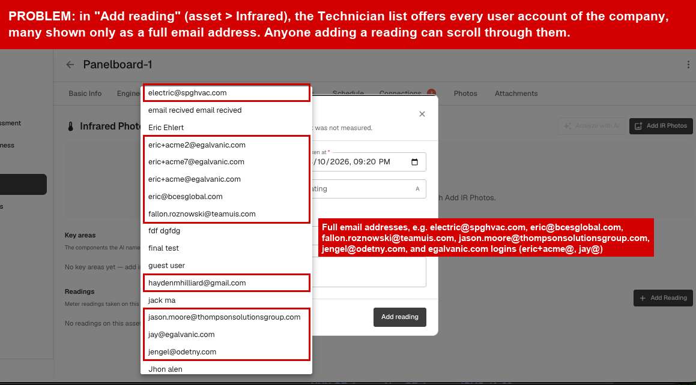

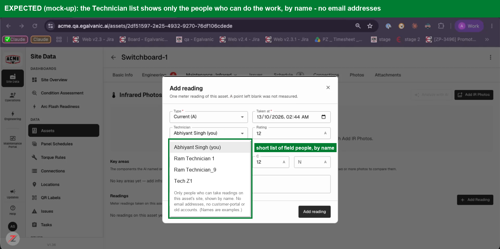

```
h3. Simple explanation
On an asset's Infrared tab, "Add reading" records a meter reading and asks who the Technician was.
The Technician list offers every user account of the company (246 on Acme QA), not just the people who do field work.
Many of them are shown only as a full email address, for example electric@spghvac.com, eric@bcesglobal.com, jason.moore@thompsonsolutionsgroup.com, and egalvanic.com logins such as jay@egalvanic.com.
Anyone who can add a reading can scroll through all these addresses.
All 246 accounts belong to Acme's own company; about 22 of them use customer email domains, and most of those are old accounts with no name, role or site.
It matters because email addresses are shown to people who do not need them, and a reading can be saved under a person who could never have taken it.
The list should offer only active people who can do the work on this site, shown by name.

!ZP-4893-key-highlighted.png|width=720!
!ZP-4893-expected-mockup.png|width=720!

Video: [^email_show.mov]

h3. Actual result
The Technician list shows all company user accounts. Users without a name are shown as their full email address (customer domains, egalvanic.com logins, test accounts), and any of them can be picked as the technician.

h3. Expected result
* The Technician list offers only people who can do the work: active users with a field / technician role who have access to this asset's site.
* People are shown by name. An email address is never used as the label (a user without a name is left out or shown as "Unnamed user").
* Customer portal contacts, accounts with no role or no site, and old seed accounts are not in the list.

h3. Test data
* Environment: https://acme.qa.egalvanic.ai (QA)
* Login used for the video and screenshots: the QA owner's account "Abhiyant Singh" (shown as "Abhiyant Singh (you)"). The list behind it returns the same 246 users to Project Manager, Facility Manager and Client Portal logins too (checked 13 Oct).
* Asset "Switchboard-1": https://acme.qa.egalvanic.ai/assets/2df51597-2e25-4932-9270-76df106cdede
* Second asset: "Panelboard-1" (Screenshot 4)
* Recorded 13–14 Oct 2026; list source checked on QA build index-G6uKkjPx.js, 14 Oct 2026 (246 users, all of them Acme company users)

h3. Steps to reproduce
1. Sign in to https://acme.qa.egalvanic.ai and open asset *Switchboard-1*: https://acme.qa.egalvanic.ai/assets/2df51597-2e25-4932-9270-76df106cdede
2. Open the *Maintenance* tab menu and choose *Infrared*. Under *Readings* click *Add Reading*. The *Add reading* window opens with *Technician* = your own name. (Screenshot 1)
!1-add-reading-dialog-technician-field.png|width=720!
3. Click the *Technician* box. Among the names the list shows full email addresses, e.g. abhiyantsingh1@egalvanic.com, abhiyantsingh2@egalvanic.com, abhiyantsingh@egalvanic.com. (Screenshot 2)
!2-technician-list-shows-email-addresses.png|width=720!
4. Scroll down: more addresses, e.g. ryanm@hustonelectric.com, scottn@hustonelectric.com, techniciansam@egalvanic.com (a pop-up overlay covers part of this screenshot). (Screenshot 3)
!3-technician-list-customer-contact-emails.png|width=720!
5. On another asset, *Panelboard-1*, the same list shows electric@spghvac.com, eric+acme@egalvanic.com, eric@bcesglobal.com, fallon.roznowski@teamuis.com, jason.moore@thompsonsolutionsgroup.com, jay@egalvanic.com and jengel@odetny.com. (Screenshot 4; highlighted copy at the top)
!4-panelboard-technician-list-emails-and-staff-logins.png|width=720!
6. Press Escape and *Cancel*; nothing needs to be saved.

h3. Notes for the developer
* The list comes from {{GET /api/eg-form-sources/users}}: all 246 users of the signed-in user's company (fields id, is_current, name; 57 of the 246 names are email addresses, checked 13 Oct). All of them are Acme company users. About 22 use customer email domains; most of those were created 29 Sep 2025 and have no name, role or sites (one is a real Acme Project Manager / Electrical Engineer).
* The same users list feeds the torque record "Technician" picker and EG form "Users" fields, so the same filter (active, field role, access to the asset's site, label by name) should apply there too.
* Related: ZP-4710 (asset readings), ZP-4867 (same users list).
```
